# WeeLink

Tempel link postingan publik dari Instagram, TikTok, Threads, YouTube, atau situs lain, lalu simpan videonya, gambarnya, atau MP3-nya dengan kualitas yang kamu pilih. Tanpa akun, tanpa database.

<p align="center">
  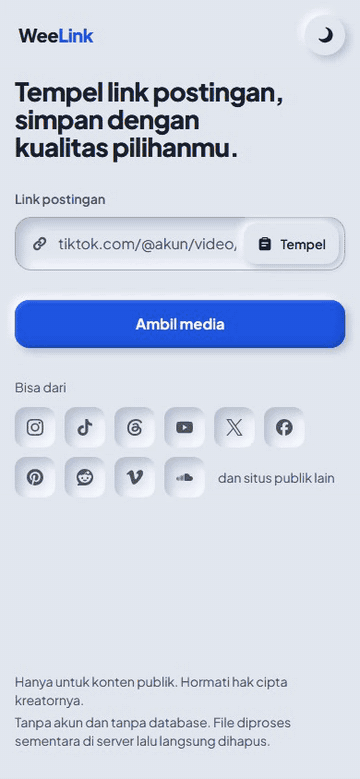
</p>

Dibangun dengan Next.js 16 (App Router, Cache Components), React 19, TypeScript, dan Tailwind CSS 4. Pengambilan media memakai [yt-dlp](https://github.com/yt-dlp/yt-dlp) dan [ffmpeg](https://ffmpeg.org/) di sisi server.

## Daftar isi

- [Screenshot](#screenshot)
- [Fitur](#fitur)
- [Platform yang didukung](#platform-yang-didukung)
- [Menjalankan secara lokal](#menjalankan-secara-lokal)
- [Konfigurasi](#konfigurasi)
- [Cara kerja](#cara-kerja)
- [Struktur project](#struktur-project)
- [API](#api)
- [Deploy](#deploy)
- [Desain](#desain)
- [Aksesibilitas](#aksesibilitas)
- [Batasan yang diketahui](#batasan-yang-diketahui)
- [Memperbarui screenshot dan GIF](#memperbarui-screenshot-dan-gif)

## Screenshot

Mobile adalah tampilan utama. Semua gambar di bawah diambil dari build produksi dengan `npm run docs:capture`.

| Awal | Membaca link | Hasil (video) | Hasil (MP3) |
| :---: | :---: | :---: | :---: |
| 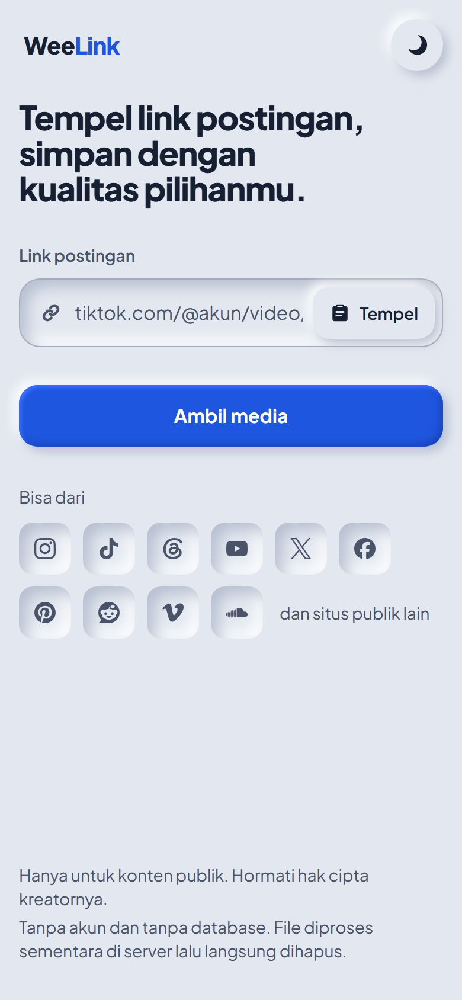 | 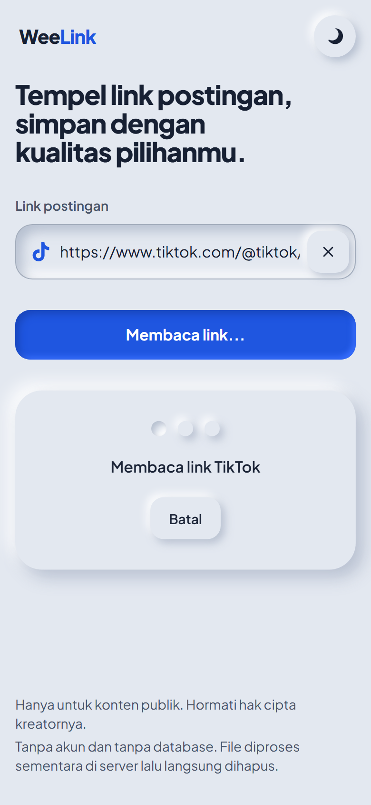 | 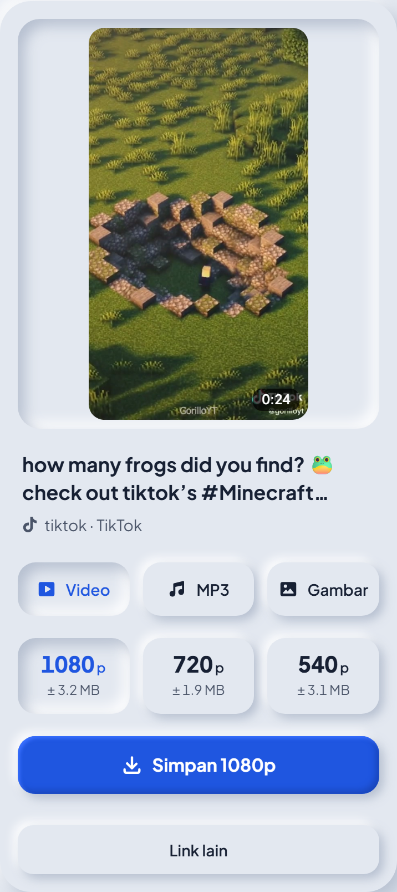 | 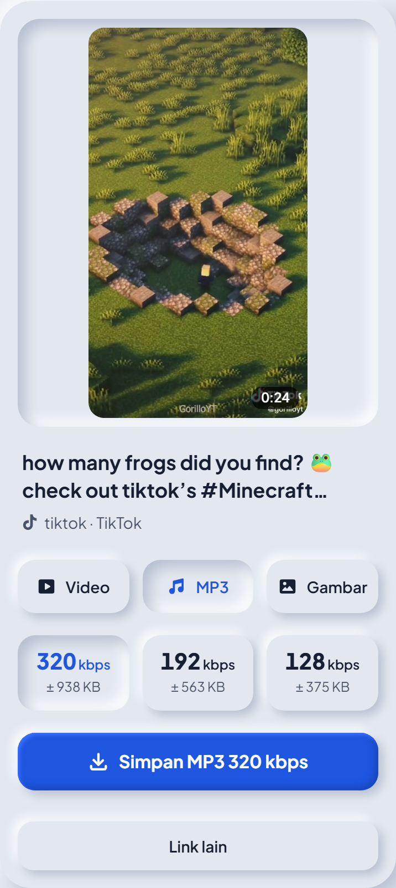 |

| Error | Mode gelap | Mode gelap (hasil) | Tablet |
| :---: | :---: | :---: | :---: |
| 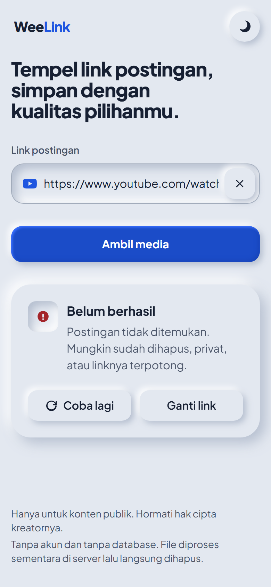 | 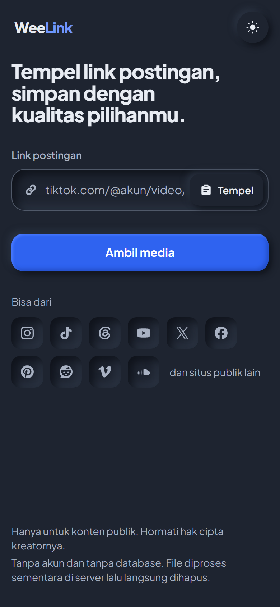 | 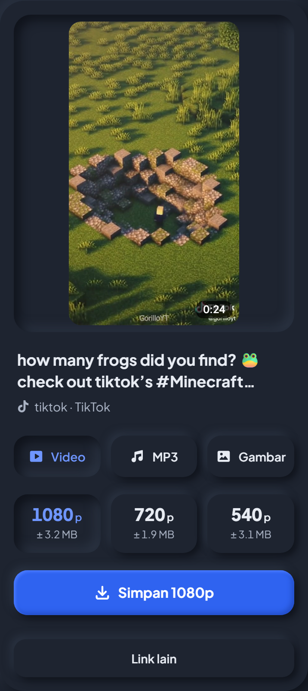 | 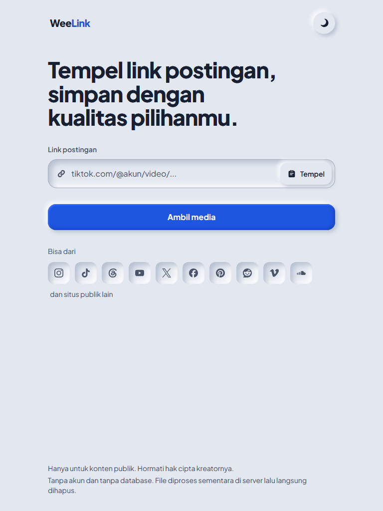 |

Desktop memakai dua kolom: form tetap di kiri, hasil di kanan.

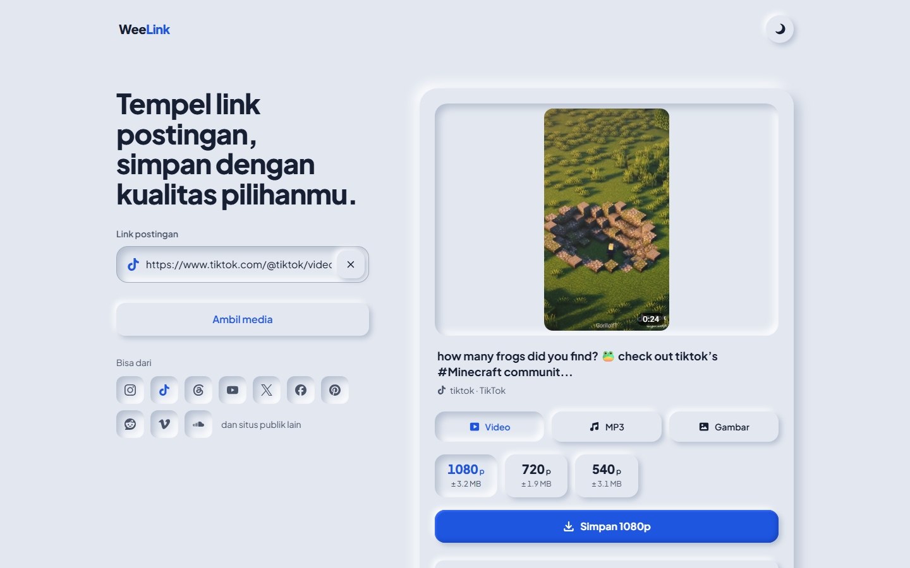
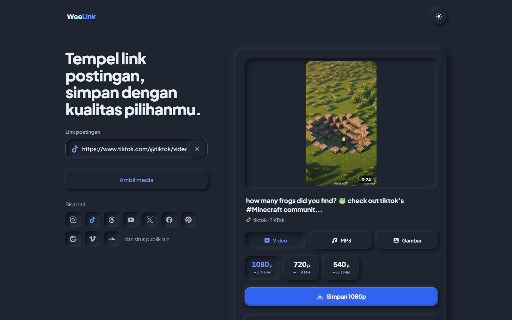

## Fitur

- **Satu kolom, satu tombol.** Tempel link lalu tekan Ambil media. Menempel link langsung ke kolom (atau lewat tombol Tempel) otomatis memprosesnya.
- **Teks share tetap bisa dipakai.** Teks seperti `Lihat video ini https://vt.tiktok.com/...` diterima apa adanya; link-nya diambil dari dalam teks.
- **Kualitas bebas dipilih.** Video sesuai resolusi yang tersedia di sumber (misalnya 1080p, 720p, 540p). Audio dikonversi ke MP3 320, 192, atau 128 kbps. Gambar asli, atau sampul untuk video.
- **Perkiraan ukuran file**, kalau sumbernya melaporkan ukuran.
- **Carousel** (beberapa item dalam satu postingan) bisa dipilih per item.
- **Video yang bisa diputar di galeri ponsel.** Server memilih H.264 + AAC dalam MP4 kalau tersedia di resolusi yang dipilih.
- **Progress unduhan** di dalam tombol Simpan, dan bisa dibatalkan.
- **Bagikan ke WeeLink.** Setelah dipasang sebagai aplikasi (PWA) di Android, WeeLink muncul di menu Bagikan aplikasi lain.
- **Mode terang dan gelap**, mengikuti sistem secara default, dengan toggle yang tersimpan per perangkat.
- **Tanpa login, tanpa database.** Pilihan unduhan dibawa sebagai token bertanda tangan, dan file sementara dihapus begitu selesai dikirim.

## Platform yang didukung

WeeLink membaca link lewat yt-dlp, jadi secara teori [semua situs yang didukung yt-dlp](https://github.com/yt-dlp/yt-dlp/blob/master/supportedsites.md) ikut didukung. Tabel di bawah mencatat apa yang **benar-benar diuji** saat project ini dibuat (November 2026):

| Platform | Status | Catatan |
| --- | --- | --- |
| YouTube | Diuji, berhasil | Video, MP3, dan sampul tersimpan. yt-dlp memakai Node yang menjalankan server sebagai JS runtime. YouTube kadang membalas 403 pada percobaan pertama; server otomatis mencoba sekali lagi. |
| TikTok | Diuji, berhasil | Pilihan 1080p, 720p, 540p, MP3, dan sampul. |
| Instagram | Diuji, gagal tanpa cookies | Instagram sering menolak permintaan anonim dari server ("login required"). Isi `YTDLP_COOKIES_FILE` untuk meningkatkan keberhasilan. Pengunjung tetap tidak perlu login. |
| Threads | Belum terverifikasi | yt-dlp tidak punya ekstraktor Threads. WeeLink mencoba membaca gambar atau video dari tag Open Graph halaman. Belum ada link postingan publik yang berhasil diuji. |
| X, Facebook, Pinterest, Reddit, Vimeo, SoundCloud | Belum diuji | Ditangani yt-dlp. Satu percobaan Vimeo gagal saat pengujian. |

Logo platform di halaman hanya informasi, bukan jaminan. Kalau sebuah link gagal, pengguna melihat penyebabnya (tidak ditemukan, diminta login, ditolak platform, dan seterusnya) beserta langkah berikutnya.

## Menjalankan secara lokal

Kebutuhan: Node.js 20.9 atau lebih baru.

```bash
npm install
npm run setup     # mengunduh binary yt-dlp resmi ke ./bin
npm run dev       # http://localhost:3000
```

`npm run setup` mengambil build standalone yt-dlp untuk OS kamu (Windows, macOS, Linux x64/arm64), jadi Python tidak diperlukan. ffmpeg ikut terpasang lewat paket `ffmpeg-static`. Kalau npm menahan install script `ffmpeg-static`, jalankan `npm install-scripts approve ffmpeg-static` lalu `npm rebuild ffmpeg-static`, atau isi `FFMPEG_PATH` dengan ffmpeg milik sistem.

yt-dlp perlu diperbarui berkala karena platform sering berubah. Jalankan `npm run setup` lagi untuk mengambil versi terbaru.

### Script npm

| Script | Fungsi |
| --- | --- |
| `npm run dev` | Server pengembangan |
| `npm run build` / `npm start` | Build dan jalankan versi produksi |
| `npm run lint` | ESLint |
| `npm run typecheck` | Pemeriksaan tipe TypeScript |
| `npm run setup` | Unduh atau perbarui yt-dlp ke `./bin` |
| `npm run icons:render` | Render ikon PWA PNG dari `public/icon.svg` |
| `npm run docs:capture` | Ambil ulang screenshot dan GIF demo |

## Konfigurasi

Salin `.env.example` ke `.env.local`. Semua variabel opsional.

| Variabel | Default | Fungsi |
| --- | --- | --- |
| `WEELINK_SECRET` | acak per proses | Kunci HMAC untuk token unduhan. Wajib diisi kalau ada lebih dari satu instance server. |
| `YTDLP_PATH` | `./bin/yt-dlp`, lalu `yt-dlp` di PATH | Lokasi binary yt-dlp. |
| `FFMPEG_PATH` | binary dari `ffmpeg-static` | Lokasi binary ffmpeg. |
| `YTDLP_COOKIES_FILE` | kosong | File cookies format Netscape untuk yt-dlp. Membantu Instagram. |
| `MAX_CONCURRENT_JOBS` | `3` | Jumlah proses yt-dlp yang boleh berjalan bersamaan; sisanya antre. |
| `MAX_DURATION_SECONDS` | `10800` | Batas durasi media (3 jam). |
| `RESOLVE_LIMIT_PER_10_MIN` | `30` | Batas baca link per IP per 10 menit. |
| `DOWNLOAD_LIMIT_PER_10_MIN` | `30` | Batas unduhan per IP per 10 menit. Pratinjau gambar tidak dihitung. |

## Cara kerja

```
Browser                         Server Next.js                       Luar
───────                         ──────────────                       ────
Tempel link ──POST /api/resolve──▶ cek URL (bukan IP lokal/privat)
                                  yt-dlp --dump-single-json ─────────▶ platform
                                  └ gagal? baca tag Open Graph ──────▶ halaman postingan
                                  susun pilihan kualitas
                                  tandatangani tiap pilihan (HMAC)
◀──────── JSON + token ──────────
Pilih kualitas, Simpan
       ──GET /api/download?t=…──▶ verifikasi token
                                  yt-dlp + ffmpeg ke folder temp ───▶ platform
◀────── stream file ────────────  hapus folder temp setelah terkirim
Simpan sebagai file
```

**Kenapa tanpa database bisa jalan.** Setiap pilihan unduhan (URL sumber, mode, kualitas, nama file, waktu kedaluwarsa) dikemas jadi token yang ditandatangani HMAC-SHA256 di [lib/server/token.ts](lib/server/token.ts). Browser hanya menyimpan token itu selama halaman terbuka. Saat diminta mengunduh, server cukup memverifikasi tanda tangannya. Token berlaku satu jam. Tidak ada data pengguna yang disimpan.

**Keamanan dasar.**
- yt-dlp dijalankan tanpa shell, dengan argumen berupa array dan `--` sebelum URL, jadi URL tidak pernah dibaca sebagai perintah.
- URL ke `localhost`, IP privat, atau link-local ditolak supaya server tidak bisa dipakai memindai jaringannya sendiri ([lib/server/url-guard.ts](lib/server/url-guard.ts)).
- File langsung (gambar, sampul) hanya diambil dari URL yang ada di dalam token bertanda tangan, bukan dari input pengguna.
- Rate limit per IP dan antrean proses yt-dlp membatasi beban.

## Struktur project

```
wee-link/
├── app/
│   ├── api/
│   │   ├── resolve/route.ts       POST: baca link, kembalikan pilihan unduhan
│   │   └── download/route.ts      GET: verifikasi token, stream file
│   ├── globals.css                Design token, komponen neumorphic, animasi
│   ├── layout.tsx                 Font, metadata, script tema anti-flash
│   ├── page.tsx                   Halaman tunggal
│   ├── manifest.ts                Manifest PWA + share target
│   └── icon.svg                   Favicon
├── components/
│   ├── downloader/
│   │   ├── downloader.tsx         Orkestrator: form di kiri, hasil di kanan
│   │   ├── shared-link-downloader.tsx  Membaca ?text= dari menu Bagikan
│   │   ├── link-form.tsx          Kolom link, tombol Tempel, validasi
│   │   ├── platform-strip.tsx     Logo platform yang didukung
│   │   ├── status-panels.tsx      State kosong, memuat, dan error
│   │   ├── result-card.tsx        Pratinjau, pilihan item, format, kualitas
│   │   ├── option-picker.tsx      Keycap format dan kualitas (radio native)
│   │   └── save-button.tsx        Tombol Simpan dengan progress
│   ├── site/                      Header dan footer
│   └── ui/                        Ikon, logo platform, toggle tema
├── hooks/
│   ├── use-media-resolver.ts      State machine baca link, bisa dibatalkan
│   └── use-file-download.ts       Unduh dengan progress, simpan sebagai file
├── lib/
│   ├── platforms.ts               Daftar platform, deteksi, ekstraksi URL
│   ├── types.ts                   Tipe bersama client dan server
│   ├── format.ts                  Format ukuran, durasi, label
│   ├── theme.ts                   Kunci storage dan script tema
│   └── server/                    Hanya dipakai di server
│       ├── resolve.ts             Alur baca link + fallback
│       ├── ytdlp.ts               Menjalankan yt-dlp, antrean, pemetaan error
│       ├── normalize.ts           Output yt-dlp menjadi pilihan kualitas
│       ├── og-fallback.ts         Baca gambar/video dari tag Open Graph
│       ├── download.ts            Siapkan file di folder temp lalu stream
│       ├── token.ts               Token bertanda tangan HMAC
│       ├── url-guard.ts           Tolak URL lokal dan privat
│       ├── rate-limit.ts          Batas permintaan per IP (di memori)
│       ├── env.ts                 Baca angka dari environment
│       └── errors.ts              Kode error dan pesan untuk pengguna
├── scripts/
│   ├── setup-yt-dlp.mjs           Unduh binary yt-dlp
│   ├── render-icons.mjs           Render ikon PWA PNG
│   └── capture-docs.mjs           Screenshot dan GIF untuk README
├── public/                        icon.svg dan icons/ (PNG PWA)
├── docs/                          demo.gif dan screenshots/
├── Dockerfile
└── .env.example
```

Aturan pemisahan: semua yang menyentuh proses, file sistem, atau kunci rahasia ada di `lib/server/` dan hanya diimpor oleh route handler. Komponen di `components/` tidak pernah mengimpor dari `lib/server/`.

## API

### `POST /api/resolve`

```json
{ "url": "https://www.tiktok.com/@tiktok/video/7106594312292453675" }
```

Respons sukses (dipersingkat):

```json
{
  "platform": "tiktok",
  "title": "how many frogs did you find? ...",
  "author": "tiktok",
  "entries": [
    {
      "id": "7106594312292453675-0",
      "previewUrl": "/api/download?t=...&inline=1",
      "durationSec": 24,
      "options": [
        { "id": "video-1080", "mode": "video", "value": "1080", "unit": "p", "sizeBytes": 3360445, "token": "..." },
        { "id": "audio-320", "mode": "audio", "value": "320", "unit": "kbps", "sizeBytes": 960000, "token": "..." },
        { "id": "image-cover", "mode": "image", "value": "Sampul", "token": "..." }
      ]
    }
  ]
}
```

### `GET /api/download?t=<token>`

Mengirim file sebagai attachment. Tambahkan `&inline=1` untuk pratinjau gambar. Header `x-file-size` berisi ukuran file untuk progress bar.

### Error

Kedua endpoint membalas error dalam bentuk yang sama:

```json
{ "error": { "code": "NOT_FOUND", "message": "Postingan tidak ditemukan. Mungkin sudah dihapus, privat, atau linknya terpotong." } }
```

| Kode | HTTP | Kapan |
| --- | --- | --- |
| `INVALID_URL` | 400 | Input bukan link |
| `BLOCKED_URL` | 400 | Link ke alamat lokal atau privat |
| `UNSUPPORTED` | 422 | Situs atau jenis link tidak dikenali (misalnya profil, bukan postingan) |
| `NO_MEDIA` | 422 | Tidak ada media yang bisa diambil |
| `NOT_FOUND` | 404 | Postingan dihapus, privat, atau link terpotong |
| `LOGIN_REQUIRED` | 403 | Platform meminta login |
| `REFUSED` | 403 | Platform menolak server, atau postingan sudah tidak ada (TikTok tidak membedakan keduanya) |
| `TOO_LONG` | 413 | Melebihi `MAX_DURATION_SECONDS` |
| `TOKEN_EXPIRED` | 410 | Token unduhan tidak valid atau lewat satu jam |
| `RATE_LIMITED` | 429 | Melebihi batas per IP |
| `ENGINE_MISSING` | 503 | yt-dlp tidak ditemukan |
| `UPSTREAM` | 502 | Kegagalan lain dari platform |

## Deploy

WeeLink butuh server Node yang bisa menjalankan binary dan menulis ke folder temp. **Vercel dan serverless sejenis tidak cocok**: binary yt-dlp dan ffmpeg besar, unduhan bisa melewati batas waktu fungsi, dan token butuh `WEELINK_SECRET` yang sama di semua instance.

### Docker

```bash
docker build -t weelink .
docker run -p 3000:3000 -e WEELINK_SECRET=ganti-dengan-string-acak weelink
```

Image memasang ffmpeg dari Debian dan yt-dlp standalone untuk Linux. Untuk memperbarui yt-dlp, build ulang image-nya.

> Dockerfile ini belum diuji build di mesin pengembangan project ini. Kalau ada langkah yang gagal, kabari atau buka issue.

### VPS biasa

```bash
npm ci
npm run setup
npm run build
WEELINK_SECRET=... npm start
```

Pasang di belakang reverse proxy (Nginx, Caddy). Rate limit membaca `x-forwarded-for`, jadi pastikan proxy mengisinya. Naikkan timeout proxy untuk `/api/download`, karena video panjang bisa butuh beberapa menit untuk disiapkan sebelum byte pertama dikirim.

## Desain

**Arah desain:** utility web app satu tugas untuk pengguna media sosial sehari-hari, bahasa visual full soft-neumorphism, biru solid sebagai warna utama. Dial: ENERGY 2 / RHYTHM 1 / MOTION 2.

- **Material tunggal.** Seluruh halaman satu warna permukaan. Kedalaman dibaca dari cahaya dan bayangan, dan bayangan selalu punya arti: **timbul** berarti bisa ditekan, **cekung** berarti kolom input, pilihan aktif, atau sedang ditekan.
- **Motif identitas: keycap.** Pilihan format dan kualitas berbentuk tombol fisik dengan angka besar (1080, 720, 320). Yang dipilih tetap tertekan masuk.
- **Satu aksen.** Biru solid hanya dipakai untuk satu aksi utama per layar (Ambil media, lalu Simpan setelah hasil muncul) dan untuk penanda fokus atau pilihan. Logo platform sengaja digambar monokrom supaya sepuluh warna brand tidak berebut perhatian.
- **Tipografi:** Plus Jakarta Sans, dibuat oleh Tokotype di Jakarta. Cocok untuk produk berbahasa Indonesia, dan bentuknya yang membulat pas dengan permukaan timbul.
- **Ikon** digambar sendiri dalam gaya isi (filled) agar menyatu dengan permukaan neumorphic. Logo platform diambil dari [Simple Icons](https://simpleicons.org/).
- **Gerak punya tujuan:** tombol tenggelam saat ditekan (umpan balik sentuh), kartu hasil naik dari permukaan (menyambung gerakan tombol yang baru ditekan), keycap tenggelam saat dipilih, progress mengisi tombol Simpan. Titik memuat hanya bergerak selama permintaan berjalan. Semua animasi mati di bawah `prefers-reduced-motion`.
- **Layout tiga tahap:** satu kolom di ponsel, satu kolom terpusat (maks. 36rem) di tablet, dua kolom mulai 1024px.

**Catatan (antislop R-12):** neumorphism memberi bayangan pada hampir semua elemen, dan itu bertabrakan dengan pola "bayangan lembut di mana-mana". Gaya ini dipertahankan karena diminta secara eksplisit sebagai identitas produk, dengan syarat setiap bayangan membawa makna timbul atau cekung seperti dijelaskan di atas.

### Palet

Rasio kontras dihitung dengan rumus WCAG 2.x.

| Token | Terang | Gelap | Kontras |
| --- | --- | --- | --- |
| `--surface` | `#e3e8f0` | `#1e2430` | |
| `--ink` (teks utama) | `#172033` | `#e8ecf3` | 13.22 / 13.13 |
| `--muted` (teks sekunder) | `#4a5468` | `#a9b2c3` | 6.19 / 7.29 |
| `--primary` (tombol, teks putih) | `#1f56e0` | `#2f63f0` | 6.06 / 5.04 |
| `--accent-text` (teks biru, fokus) | `#1f56e0` | `#6f96ff` | 4.92 / 5.54 |
| `--danger` | `#a3242a` | `#ff9b9b` | 6.00 / 7.71 |
| `--edge` (batas kolom input) | `#6e7a90` | `#7a8599` | 3.52 / 4.18 (komponen UI, min. 3:1) |

### Logo

Wordmark "WeeLink" berupa teks. `app/icon.svg` dan ikon PWA (huruf W di kotak biru) adalah **placeholder** yang diturunkan dari wordmark. Ganti `public/icon.svg` dan `app/icon.svg` dengan logo asli, lalu jalankan `npm run icons:render`.

## Aksesibilitas

- Semua kontrol bisa dipakai dengan keyboard. Pilihan format dan kualitas memakai radio native, jadi tombol panah berfungsi.
- Indikator fokus terlihat di kedua tema. Kolom link memakai cincin fokus pada wadahnya.
- Setelah hasil muncul, fokus pindah ke judul hasil. Di ponsel, halaman ikut menggulir ke hasil.
- Status memuat, selesai, dan error diumumkan lewat `role="status"` atau `role="alert"`. Error selalu berupa teks dengan ikon, tidak hanya warna merah.
- Target sentuh minimal 44 x 44 px. Tidak ada overflow horizontal dari 320px sampai 1440px.
- Ada link "Langsung ke isi" untuk pengguna keyboard. Zoom tidak dikunci.

## Batasan yang diketahui

- **File ditampung di memori browser** sebelum disimpan, supaya progress bisa ditampilkan. Untuk klip media sosial ini tidak masalah, tapi video YouTube yang sangat panjang bisa membebani ponsel dengan RAM kecil.
- **Rate limit dan antrean ada di memori proses.** Kalau server di-restart, keduanya kembali ke nol, dan dengan beberapa instance batasnya berlaku per instance.
- **Penjaga SSRF memeriksa nama host, bukan hasil DNS.** Domain publik yang mengarah ke IP privat tidak tertangkap. Jalankan server di jaringan yang tidak bisa menjangkau layanan internal yang sensitif.
- **Platform berubah-ubah.** Kalau sebuah platform mendadak gagal, langkah pertama selalu memperbarui yt-dlp (`npm run setup`).

## Memperbarui screenshot dan GIF

```bash
npx playwright install chromium   # sekali saja
npm run build && npm start         # jalankan build produksi
BASE_URL=http://localhost:3000 npm run docs:capture
```

Ganti link demo dengan `DEMO_LINK="https://..."`. GIF dibuat dari rekaman Playwright lalu dikonversi dengan ffmpeg. Titik biru yang muncul saat tombol ditekan hanya disuntikkan selama perekaman.

## Etika

WeeLink hanya untuk konten publik. Menyimpan karya orang lain untuk keperluan pribadi berbeda dengan mengunggahnya ulang. Hormati hak cipta kreator dan ketentuan layanan tiap platform.
